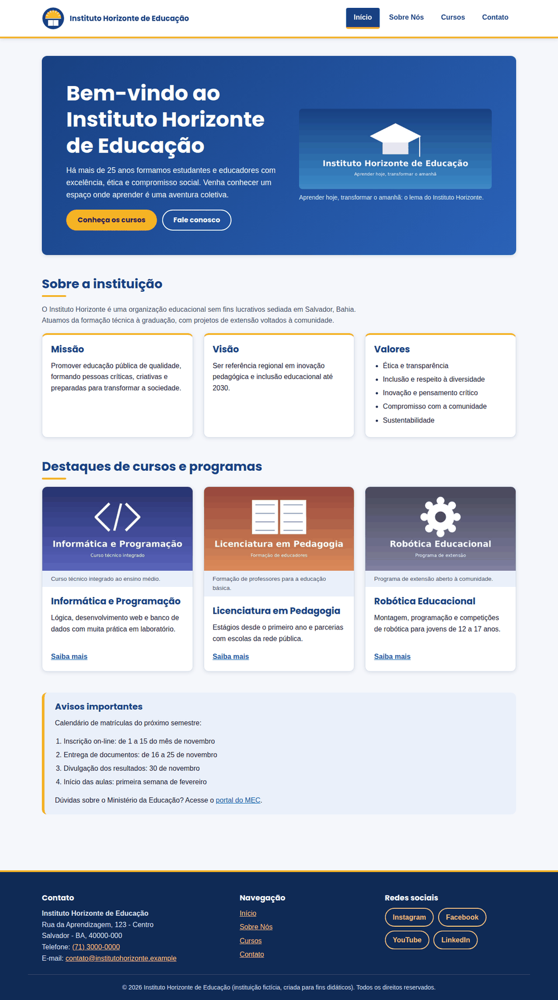
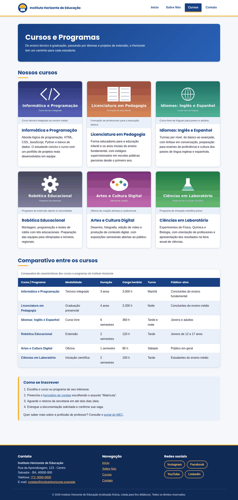
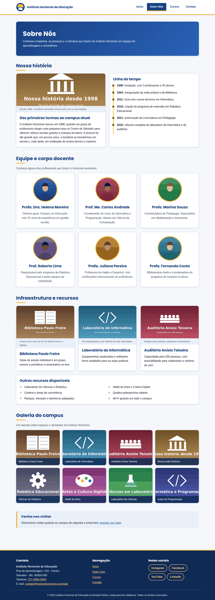
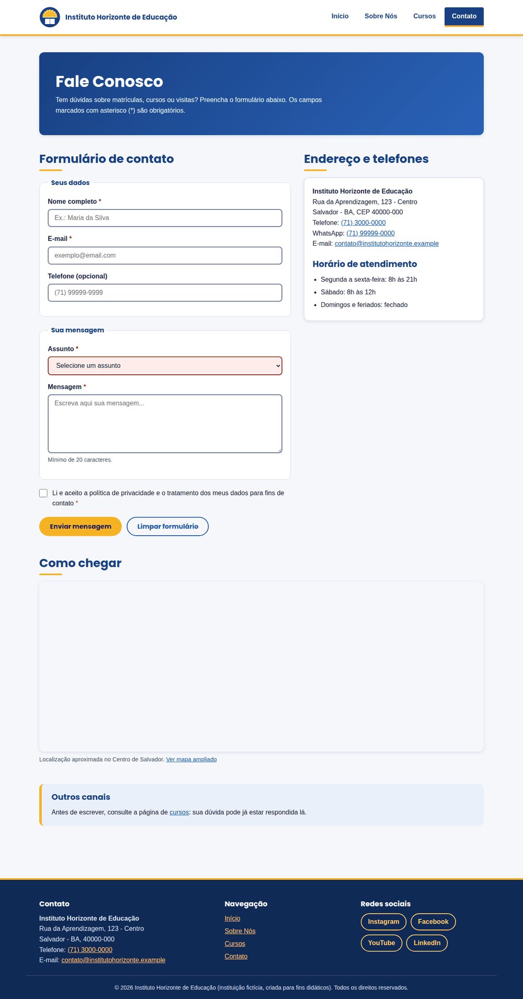
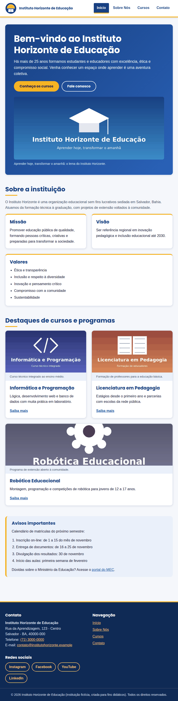
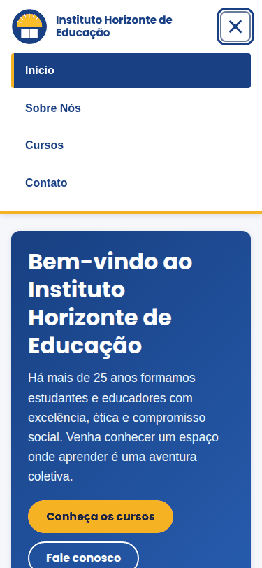
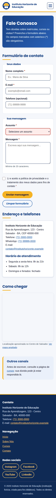
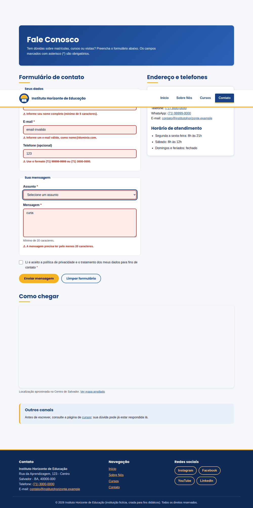
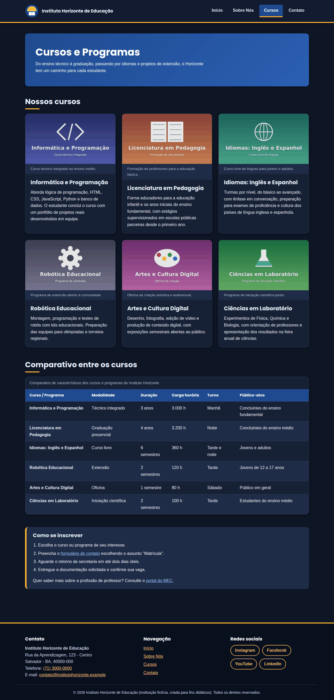
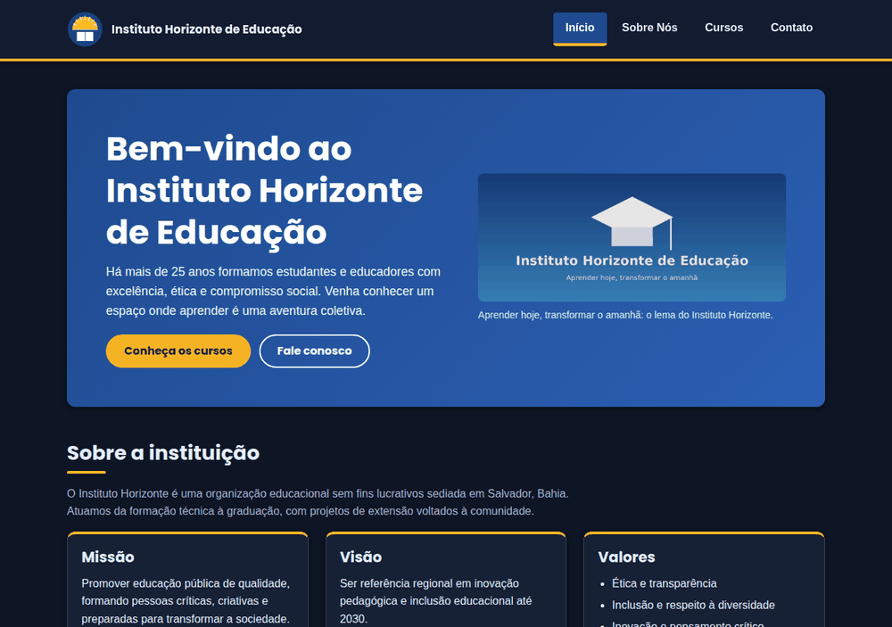

# Trabalho 2: Estilização e Responsividade com CSS

**Instituição (fictícia):** Instituto Horizonte de Educação
**Disciplina / Curso:** Licenciatura em Computação (EAD), UFRB

## Descrição

Estilização do site institucional do Trabalho 1 com **CSS3 puro (vanilla CSS)**,
sem frameworks, aplicando princípios de design visual e layouts responsivos
com **Flexbox** e **Grid**. O HTML semântico do Trabalho 1 foi mantido; foram
adicionadas apenas classes semânticas (padrão `bloco__elemento--modificador`),
a galeria de imagens e o rodapé com redes sociais.

## Estrutura de arquivos

```
trabalho2/
├── index.html
├── sobre.html
├── cursos.html
├── contato.html
├── css/
│   ├── style.css         Estilos principais (mobile first), por seções
│   └── responsive.css    Ajustes de tablet (768px+) e desktop (1024px+)
├── images/               18 imagens do projeto
├── screenshots/          Capturas de tela usadas neste README
└── README.md
```

## Como executar

Abra o `index.html` em qualquer navegador. Não há instalação nem etapa de build.
A internet é necessária apenas para as fontes do Google Fonts e para o mapa da
página de contato (se as fontes não carregarem, o site usa Segoe UI/Arial).

## Decisões de design

### Tipografia
- **Poppins** (600/700) nos títulos e botões; **Nunito Sans** (400/600/700) no texto, ambas do Google Fonts.
- Tamanhos em `rem` (escalam com a preferência de fonte do usuário), `line-height` de 1.6 no texto e 1.25 nos títulos.
- Hierarquia: `h1` > `h2` > `h3` com tamanhos crescentes em tablet e desktop.

### Paleta de cores (4 cores principais)
| Papel | Cor | Uso |
|-------|-----|-----|
| Azul-marinho | `#184082` | Títulos, hero, cabeçalho da tabela, item ativo do menu |
| Amarelo | `#f5b324` | Botão principal, detalhes e destaques (herdado do logo) |
| Cinza-claro / branco | `#f5f7fb` / `#ffffff` | Fundo da página e cards |
| Texto escuro | `#1d2433` | Texto corrido |

Todas as cores ficam em variáveis CSS (`:root`), o que garante consistência em
todo o site e facilita o modo escuro.

### Contraste (WCAG AA exige 4,5:1 para texto)
Razões calculadas com a fórmula de luminância relativa da WCAG:

| Combinação | Razão |
|------------|-------|
| Texto / fundo da página | 14,5:1 |
| Texto secundário / fundo da página | 7,0:1 |
| Links / branco | 7,1:1 |
| Branco / hero (ponto mais claro do degradê) | 5,9:1 |
| Texto escuro / botão amarelo | 8,4:1 |
| Mensagem de erro / branco | 6,5:1 |
| Rodapé: texto / fundo | 11,0:1 |
| Modo escuro: texto / card | 13,4:1 |
| Modo escuro: link / card | 8,1:1 |

Também foram usados: bordas de campos com 4,3:1 (mínimo de 3:1 para elementos
não textuais), indicador de foco de 3px em todos os elementos interativos e
links sempre sublinhados no texto corrido.

### Espaçamento
Escala consistente baseada em `rem` (0,5 / 0,75 / 1 / 1,25 / 1,5 / 2 / 3 rem),
com 3rem de espaço vertical entre as seções.

## Responsividade

Abordagem **mobile first**: `style.css` vale para telas pequenas e
`responsive.css` acrescenta regras com `min-width`.

| Breakpoint | Largura | Adaptações |
|------------|---------|-----------|
| Mobile | até 767px | Coluna única, menu hambúrguer, tabela com rolagem horizontal, galeria em 1 coluna |
| Tablet | 768px a 1023px | Menu horizontal, cards em 2 colunas, rodapé em 2 colunas |
| Desktop | 1024px ou mais | Cards em 3 colunas, hero em 2 colunas, formulário e endereço lado a lado, rodapé em 3 colunas |

- Imagens: `max-width: 100%` e `object-fit: cover` nos cards e na galeria.
- Menu hambúrguer feito **só com CSS** (checkbox + label), acessível por teclado e com foco visível.
- Layouts com **Grid** (cards, galeria, hero, rodapé, formulário) e **Flexbox** (cabeçalho, menu, botões, redes sociais).

## Componentes especiais

- **Formulário:** campos com borda, padding e cor; estado de foco; borda e mensagem de erro em vermelho quando o campo preenchido é inválido; borda verde quando válido; botão de envio com efeito de hover.
- **Tabela:** cabeçalho azul destacado, linhas zebradas, hover nas linhas e rolagem horizontal no mobile (com dica de uso para o usuário).
- **Galeria (sobre.html):** grid uniforme de 8 imagens que ajusta o número de colunas sozinho, com zoom e legenda destacada no hover.

## Bonificações implementadas

- **Animações CSS:** entrada suave das seções e dos cards (escalonada), transições de hover nos cards, botões e links, e o ícone do hambúrguer que vira "X". Todas respeitam `prefers-reduced-motion`.
- **Dark mode:** ativado automaticamente conforme a preferência do sistema (`prefers-color-scheme: dark`), com paleta própria e contrastes verificados.

## Validação e testes

| Verificação | Resultado |
|-------------|-----------|
| W3C CSS Validator (perfil CSS level 3 + SVG), `style.css` e `responsive.css` | 0 erros (apenas avisos informativos sobre variáveis CSS) |
| Nu HTML Checker (validador HTML do W3C), 4 páginas | 0 erros e 0 avisos |
| Uso de `!important` | Nenhum |
| Rolagem horizontal indevida em 375px, 820px e 1280px | Nenhuma, nas 4 páginas |
| Chrome/Chromium (DevTools e testes automatizados) | OK |


## Screenshots

### Desktop (1280px)





### Tablet (820px)



### Mobile (375px)





### Componentes e modo escuro




> Observação: nas capturas, o mapa da página de contato aparece em branco porque
> foram geradas sem acesso à internet. No navegador, o mapa carrega normalmente.
